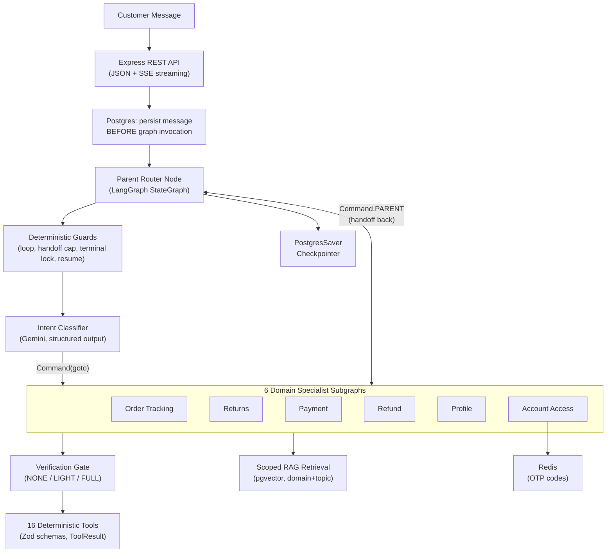

# OrchestrAI

**Stateful multi-agent orchestration platform for autonomous e-commerce customer support.**

Built with TypeScript, [LangGraph.js](https://github.com/langchain-ai/langgraphjs), PostgreSQL + pgvector, Redis, Drizzle ORM, and Vitest. 650+ automated tests. Zero stubs in production paths.

> [!NOTE]
> This is a portfolio-grade engineering project demonstrating production-quality multi-agent architecture — not a chatbot wrapper. The sophistication lives in stateful routing, specialist subgraphs, parent handoffs/re-routing, durable state, deterministic security gates, trace-driven debugging, and evaluation.

---

## Table of Contents

- [Architecture Overview](#architecture-overview)
- [The Three Handoff Patterns](#the-three-handoff-patterns)
- [Domain Specialists](#domain-specialists)
- [Deterministic Security & Access Control](#deterministic-security--access-control)
- [Evaluation Framework](#evaluation-framework)
- [Tech Stack](#tech-stack)
- [Quick Start](#quick-start)
- [Project Structure](#project-structure)
- [Testing](#testing)
- [Docker & Production Deployment](#docker--production-deployment)
- [Key Design Decisions](#key-design-decisions)

---

## Architecture Overview



The parent graph is a **LangGraph StateGraph** that owns the full `ConversationState`. Each specialist runs as a subgraph invoked via `Command({ goto })`. Specialists hand control back to the parent router via `Command({ graph: Command.PARENT })`, which enables stateful re-routing without losing context.

---

## The Three Handoff Patterns

These patterns are the architectural core of OrchestrAI — they define how control flows between agents:

### Pattern A: Direct Specialist Resolution

```
User → Router → Specialist → COMPLETED
```

The simplest flow. The router classifies intent, dispatches to the correct specialist, and the specialist resolves the query using its tools and RAG knowledge within a single subgraph invocation.

**Example:** *"Where is my order #ORD-001?"* → Order Tracking → `get_order` + `get_shipment_status` → response.

### Pattern B: Lateral Re-Route via Parent

```
User → Router → Specialist A → [out of scope] → Command.PARENT → Router → Specialist B → COMPLETED
```

When a specialist detects the query requires a different domain (e.g., a Payment specialist finds a duplicate charge requiring a refund), it hands back to the parent with a `HandoffRequest` containing `resumeContext`. The router re-routes to the appropriate specialist.

**Example:** *"I was charged twice for order #ORD-002"* → Payment → detects duplicate → handoff → Refund → `create_refund` → resolved.

### Pattern C: Verification Gate Block & Resume

```
User → Router → Specialist X → [insufficient verification] → BLOCKED → Router → Account Access → [OTP verify] → UNBLOCKED → Router → Specialist X resumes
```

When a specialist needs a tool requiring higher verification (e.g., `create_return` needs FULL but user is only LIGHTLY_VERIFIED), it records an `activeWorkflow` with `blockedBy`, `returnTo`, and `resumeContext`. The router dispatches to Account Access, which performs OTP verification. On success, it elevates identity status and clears the block. The router then resumes the original specialist with the preserved workflow context.

**Example:** *"I want to return order #ORD-003"* → Returns → needs FULL verification → blocked → Account Access → OTP → verified → Returns resumes → `create_return` → resolved.

---

## Domain Specialists

| Domain | Specialist | Tools | RAG Scope | Verification |
|--------|-----------|-------|-----------|-------------|
| **Orders** | Order Tracking | `get_order`, `get_shipment_status` | orders/shipping | LIGHT |
| **Orders** | Returns | `check_return_eligibility`, `create_return`, `get_return_status` | orders/returns | LIGHT → FULL |
| **Payments** | Payment | `get_payment`, `detect_duplicate_charge` | payments/payments | FULL |
| **Payments** | Refund | `create_refund`, `get_refund_status`, `get_return_by_order` | payments/refunds | FULL |
| **Account** | Profile | `get_profile`, `update_profile` | — | FULL |
| **Account** | Account Access | `start_identity_verification`, `verify_identity`, `initiate_password_reset` | account/account_security | NONE |

Each specialist is a **real, concrete LangGraph subgraph** — not a stub or prompt wrapper. Every specialist has:
- A multi-section prompt template (Identity / Objective / Scope / Phased-Workflow / Guidelines)
- Scoped tool access enforced by the gate allowlist
- Domain-and-topic-scoped RAG retrieval (never full-corpus)
- Structured handoff via the `HandoffRequest` contract

---

## Deterministic Security & Access Control

Security is **not probabilistic** — it's enforced by code, not prompts:

- **Verification Gate:** Every tool declares its requirement (`NONE` / `LIGHT` / `FULL`). The `gatedExecuteTool` function checks `satisfiesVerification(identity.status, requirement)` before execution. Failure returns a structured `ToolResult` — never throws.
- **Tool Allowlists:** Each specialist can only call tools on its allowlist. The gate rejects out-of-scope tool calls at runtime.
- **PII Redaction:** `executeTool` recursively redacts sensitive fields (`cardNumber`, `last4`, `expiresAt`, arrays of objects) from tool outputs before they enter LLM context.
- **Identity Boundary:** Only the Account Access specialist can mutate `identity` state. This is enforced by an ESLint import boundary rule and a dedicated boundary test.
- **Password Reset Isolation:** `initiate_password_reset` explicitly preserves the current identity status — it never elevates verification.

---

## Evaluation Framework

**30 canonical scenarios** covering all 6 specialists and all 3 handoff patterns, evaluated by **8 deterministic binary evaluators:**

| Evaluator | What It Checks |
|-----------|---------------|
| `ROUTING_CORRECT` | Intent classified to the right specialist |
| `HANDOFF_CORRECT` | Lateral re-routes and verification blocks triggered correctly |
| `SPECIALIST_SCOPE_CORRECT` | Specialist stayed within its domain |
| `TOOL_SELECTION_CORRECT` | Correct tools called with correct arguments |
| `STATE_PRESERVED` | State mutations (identity, routing, workflow) are correct |
| `KNOWLEDGE_GROUNDED` | Responses grounded in RAG retrieval, not hallucinated |
| `WORKFLOW_COMPLETED` | Workflow reached expected terminal state |
| `RESOLUTION_CORRECT` | Final response addresses the user's actual question |

Run the benchmark:

```bash
npm --prefix server run eval          # Terminal scorecard + markdown report
npm --prefix server test              # 559 server tests including eval integration
```

---

## Tech Stack

| Layer | Technology |
|-------|-----------|
| **Orchestration** | LangGraph.js (StateGraph, Command, PostgresSaver checkpointing) |
| **LLM** | Google Gemini (structured output, temperature 0.0 for classification) |
| **Database** | PostgreSQL 16 + pgvector (embeddings, domain data, checkpoints) |
| **Cache** | Redis 7 / Upstash Serverless Redis (OTP verification codes, TTL-based expiry) |
| **ORM** | Drizzle ORM (type-safe schema, migrations) |
| **API** | Express.js (JSON + SSE streaming, Zod validation, AppError hierarchy, health probes) |
| **Frontend** | Next.js 14 (App Router, React 18, Tailwind CSS, Lucide icons) |
| **Testing** | Vitest (559 server + 95 client = 654 tests, zero mocked LLM calls in integration) |
| **Deployment** | Docker & Docker Compose (local dev), Railway (backend runtime), Vercel (frontend edge), Neon (Postgres) |
| **Tracing** | LangSmith (optional, metadata sanitization, PII-safe) |

---

## Quick Start

### Prerequisites

- **Node.js** ≥ 20
- **Docker Desktop** with WSL2 backend (for PostgreSQL + Redis)
- **Google Gemini API key**

### Automated Setup

```powershell
# Clone the repository
git clone <repo-url> && cd OrchestrAI

# Copy and configure environment
cp .env.example .env
cp server/.env.example server/.env
# Edit .env and server/.env — set GEMINI_API_KEY, DATABASE_URL, and REDIS_URL

# One-command launch (checks Docker, runs migrations, seeds data, starts both servers)
powershell -ExecutionPolicy Bypass -File scripts/run-local.ps1
```

The script will:
1. Verify Node.js and WSL prerequisites
2. Start Docker containers (PostgreSQL + pgvector, Redis) if not running
3. Install npm dependencies
4. Run Drizzle database migrations
5. Set up LangGraph checkpointer tables
6. Seed demo marketplace data (users, orders, payments, returns)
7. Ingest knowledge base documents (5 policy docs → pgvector embeddings)
8. Launch Express API on `http://localhost:4000` and Next.js on `http://localhost:3000`

### Manual Setup

```powershell
# Start infrastructure
cd server
wsl docker compose up -d

# Install dependencies
npm install
cd ../client && npm install && cd ../server

# Database setup
npm run db:migrate
npm run checkpointer:setup
npm run db:seed
npm run knowledge:ingest

# Start services (two terminals)
npm run start              # Express API → http://localhost:4000
cd ../client && npm run dev # Next.js    → http://localhost:3000
```

### Verify Everything Works

```powershell
# Full workspace verification (lint + typecheck + tests for both server and client)
powershell -ExecutionPolicy Bypass -File scripts/verify.ps1

# Health check
curl http://localhost:4000/health
```

---

## Project Structure

```
OrchestrAI/
├── server/                         # Express + LangGraph backend
│   ├── src/
│   │   ├── api/                    # Express routes, middleware, error handling
│   │   │   ├── routes/             # health, conversation, demo, ops
│   │   │   ├── middleware/         # auth, validation, error handler
│   │   │   └── errors/             # AppError hierarchy
│   │   ├── agents/                 # LLM client, prompts, specialist subgraphs
│   │   │   ├── specialists/        # 6 domain specialists (real subgraphs)
│   │   │   ├── llm/                # Gemini wrapper (structured output)
│   │   │   ├── prompts/            # Template loader + .prompt files
│   │   │   └── handoff/            # HandoffRequest validation
│   │   ├── graphs/                 # LangGraph parent graph + router
│   │   │   └── parent/             # Router node, integration tests
│   │   ├── routing/                # Intent classifier, guards, events
│   │   ├── state/                  # ConversationState, reducers, identity
│   │   ├── tools/                  # 16 deterministic tools
│   │   │   ├── queries/            # Read-only tools
│   │   │   ├── mutations/          # Write tools (refund, return, identity)
│   │   │   └── business/           # Business logic (eligibility, duplicate detection)
│   │   ├── knowledge/              # RAG: ingestion, scoped retrieval, embeddings
│   │   ├── persistence/            # Drizzle schema, repositories, checkpointer
│   │   ├── evaluation/             # 30 scenarios, 8 evaluators, CLI runner
│   │   ├── observability/          # LangSmith trace config, metadata sanitization
│   │   ├── services/               # Conversation lifecycle, verification
│   │   └── shared/                 # Config, types
│   ├── knowledge-base/             # 5 policy markdown documents
│   ├── Dockerfile                  # Production multi-stage Docker build
│   └── docker-compose.yml          # PostgreSQL + pgvector, Redis (infrastructure)
├── client/                         # Next.js 14 frontend
│   └── src/
│       ├── app/                    # App Router pages (chat, ops, error boundaries)
│       │   └── ops/                # Ops dashboard (conversations, traces, evals)
│       ├── components/             # Chat, navigation, ops UI components
│       ├── context/                # User identity context
│       ├── hooks/                  # useChat reducer hook
│       └── lib/                    # API client, ops client
├── docs/                           # Architecture docs, decisions, roadmap
├── scripts/                        # run-local.ps1, verify.ps1
├── .github/workflows/              # CI/CD pipelines (GHCR, Railway, Vercel)
├── docker-compose.yml              # Monorepo containerized local stack
├── .env.example                    # Environment variable template
└── AGENTS.md                       # Agent operating guide
```

---

## Testing

The test suite runs against **real infrastructure** — PostgreSQL, pgvector, and Redis via Docker. No LLM API calls in the test suite; the embedding client is mocked.

```powershell
# Server tests (559 tests, 65 files)
npm --prefix server test

# Client tests (95 tests, 20 files)
npm --prefix client test

# Full workspace verification
powershell -ExecutionPolicy Bypass -File scripts/verify.ps1
```

### Test Coverage Highlights

- **14 parent graph integration tests** covering all 14 core scenarios from the evaluation matrix
- **End-to-end handoff pattern tests** for Patterns A, B, and C
- **Failure handling tests:** loop detection, tool retry + escalation, terminal state lock
- **API integration tests:** conversation lifecycle, SSE streaming, auth, payload limits
- **Security boundary tests:** identity mutation restriction, gate allowlist enforcement
- **Evaluation framework tests:** evaluator correctness, multi-turn runner, CLI output

---

## Docker & Production Deployment

### Local Development via Docker Compose

You can launch the backend services locally using the root `docker-compose.yml`:

```bash
# Build and run containers in detached mode
docker compose up -d

# View live service logs
docker compose logs -f backend

# Check container health and status
docker compose ps

# Stop containers
docker compose down
```

### Production Architecture & Cloud Deployment

OrchestrAI separates production runtime responsibilities across purpose-built platforms:

- **Frontend (Vercel)**: Deployed automatically from `client/` to Vercel's Edge/Serverless infrastructure via GitHub Actions.
- **Backend (Railway)**: Containerized with `server/Dockerfile` using `node:20-alpine` (multi-stage build), deployed via the Railway CLI (`railway up`). Exposes a lightweight `/health/live` probe to avoid cold-start timeouts.
- **Database (Neon)**: Serverless PostgreSQL 16 with `pgvector` for domain tables, LangGraph state checkpoints (`PostgresSaver`), and scoped RAG embeddings.
- **Cache (Upstash)**: Serverless Redis accessed securely over TLS (`rediss://...`) for ephemeral OTP verification codes and rate limiting.
- **CI/CD (.github/workflows/ci-cd.yml)**: Automated pipeline that runs linting, typechecking, builds backend containers to GitHub Container Registry (`ghcr.io`), and deploys directly to Railway and Vercel on pushes to `main`.

---

## Key Design Decisions

| Decision | Rationale |
|----------|-----------|
| **LangGraph StateGraph** over ReAct/chain | Explicit state machine with `Command(goto)` gives deterministic routing control, not probabilistic tool selection |
| **PostgresSaver checkpointing** | Durable conversation state survives restarts; multi-turn workflows resume from any point |
| **`ConversationStateUpdate` (not `Partial<ConversationState>`)** | Nodes emit typed update objects; reducers handle merge semantics (delta `handoffCount`, full-overwrite `identity`) |
| **Tools never throw** | Every tool returns `ToolResult { success, data?, error? }`; error handling is structural, not exception-based |
| **No tool mutates ConversationState** | State updates happen only through node return values and reducers — tools are pure data accessors |
| **`handoffCount` as delta** | Nodes emit `handoffCount: 1`; the reducer sums. No race conditions from absolute overwrites |
| **Domain+topic scoped RAG** | Each specialist queries only its knowledge scope (e.g., `orders/shipping`), never full-corpus |
| **Redis only for OTP** | Redis is never in the checkpoint path; it stores ephemeral verification codes with TTL |
| **Identity boundary enforcement** | ESLint import rule + runtime test ensures only Account Access can import `buildIdentityUpdate` |
| **Structured LLM output** | Intent classifier uses Zod schema for typed, parseable classification — no regex parsing |

---

## Architecture Interview Talking Points

1. **Why a parent router + specialist subgraphs?** Separation of concerns: routing logic (classifier + guards) stays in the parent; domain logic stays in specialists. Specialists don't know about each other — they communicate through the parent via structured `HandoffRequest` objects.

2. **How do you prevent infinite loops?** Three layers: (a) `visitedAgents` set prevents re-visiting, (b) `handoffCount` cap (max 3) escalates, (c) terminal `ESCALATED` state lock prevents re-entry into the classifier.

3. **How is verification deterministic?** The gate checks `satisfiesVerification(currentStatus, toolRequirement)` before every tool call. If insufficient, the specialist builds a `BLOCKED` workflow with `returnTo` context. No LLM decides whether to verify — the code enforces it.

4. **How do you evaluate correctness?** 30 scenarios × 8 binary evaluators = 240 assertions. Each evaluator checks a specific correctness dimension (routing, tool selection, state preservation, etc.). The CLI produces a markdown scorecard. All evaluators are deterministic — no LLM-as-judge.

5. **Why Express over tRPC / Hono?** Simplicity. Express is the most-understood Node.js framework. The API surface is small (5 route groups). The project's complexity budget is spent on orchestration, not infrastructure.

---

*Built as a portfolio demonstration of production-grade multi-agent orchestration architecture.*
