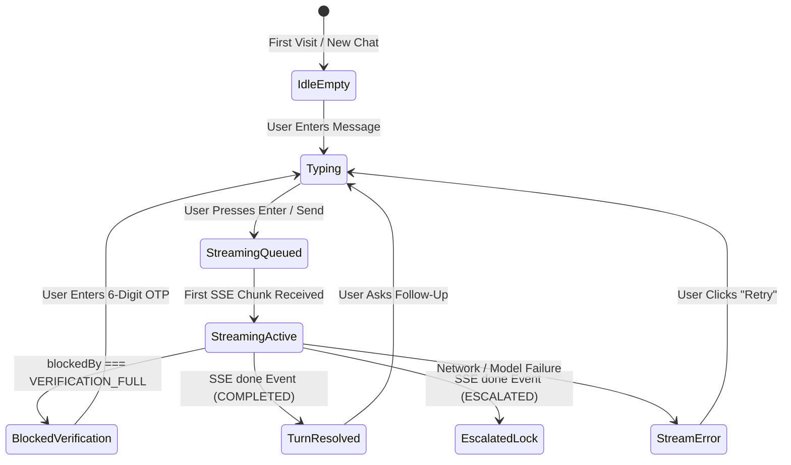

# OrchestrAI — Main Chat Experience: Visual Discovery & UX Redesign Proposal

**Author:** Antigravity Agent  
**Design Authority:** `client/ORCHESTRAI_DESIGN_SYSTEM.md`  
**Scope:** Main Customer-Facing Support Chat Experience (`/`)  
**Status:** Visual Discovery, UX Critique & Design Proposal (Read-Only)  
**Deliverable Document:** `client/ORCHESTRAI_CHAT_REDESIGN_PROPOSAL.md`  

---

## 1. Executive Summary

OrchestrAI is not a generic consumer chatbot; it is an autonomous, stateful multi-agent customer support platform powered by six specialized LangGraph subgraphs (`order_tracking`, `payment`, `returns`, `refund`, `account_access`, `profile`) and a supervisor router.

The current chat frontend (`/`) suffers from a critical identity crisis: it is rendered in a generic, light-slate consumer chat template (`bg-slate-50`, blue bubbles, floating round pills, and generic SaaS indigo buttons). It buries its most sophisticated engineering capabilities—stateful routing, monotonic handoff tracking, live node progress, and deterministic security verification—behind obscure badges, unstyled banners, and broken mobile layouts.

This proposal presents a comprehensive visual and UX overhaul of the main customer-facing chat experience. Rooted in the **Midnight Burgundy** and **Imperial Crimson** design system, the redesign transforms the chat interface into a **modern technical support console**. It introduces:
1. **Autonomous Multi-Agent Operational Awareness**: Communicates specialist routing, agent handoffs, and tool execution directly in the stream through restrained, progressive-disclosure UI markers rather than detached counters.
2. **Off-Canvas Responsive Mobile Drawer**: Resolves the severe mobile layout defect where the sidebar consumes 77% of narrow viewports.
3. **Structured Assistant Turn Architecture**: Replaces generic chat bubbles with technical message cards featuring specialist authorship, Geist Mono execution timestamps, and expandable activity telemetry.
4. **Tactile Crimson Composer**: An integrated, ergonomic message composer with active state feedback, dynamic keybinding hints, and clear escalation lock states.
5. **Authoritative Design System Compliance**: Complete alignment with `ORCHESTRAI_DESIGN_SYSTEM.md` (Manrope + Geist Mono, dark canvas `#16070B`, tonal surfaces, 4px grid, 12px/10px/8px radii, and WCAG 2.2 AA contrast).

Zero backend, API, data hook, or database schema changes are required.

---

## 2. Existing Interface Observations

An end-to-end inspection of the current customer support chat interface (`src/app/page.tsx` and related components) reveals the following baseline observations:

### 2.1 Visual & Layout Composition
* **Application Shell**: Enclosed in a 2-tier structure: global `TopNav` (56px) on top, followed by a flex row holding `ConversationSidebar` (288px–320px) and `<main>` chat area.
* **Canvas Styling**: The chat background defaults to `bg-slate-50` with an inner white header (`bg-white border-b border-slate-200`) and a white input footer (`bg-white border-t border-slate-200`).
* **Header Density**: The chat header displays a specialist badge (`SpecialistBadge`), a truncated conversation ID (`ID: abc12345...`), a "Storefront" button (`bg-slate-100 text-slate-700`), and conditional workflow status badges (`Turn Resolved` in green, `Escalated to Human` in red).
* **Sidebar Structure**: The sidebar uses dark slate (`bg-slate-900 border-slate-800`), creating a jarring split-screen contrast against the bright white/slate-50 chat feed.
* **Message Presentation**:
  * User messages: Bright blue bubbles (`bg-blue-600 text-white rounded-2xl rounded-tr-sm`) aligned to the right.
  * Assistant messages: Plain white cards (`bg-white border border-slate-200 text-slate-800 rounded-2xl rounded-tl-sm`) with standard `prose-sm` markdown typography.
  * Avatars: 32px circular pills (`rounded-full`) showing a generic `Bot` or `User` icon.
* **Agent Progress**: When streaming, a single pulsing pill (`node-progress-indicator`) displays `Working: <node>...` with spinning `Loader2` in `bg-indigo-50 text-indigo-700`.

---

## 3. Current UX Problems, Prioritized by Severity

| Rank | Severity | Issue | Impact on User Experience |
| :---: | :---: | :--- | :--- |
| **1** | **Critical** | **Mobile Sidebar Squeeze Defect** | On screens $< 768\text{px}$, the sidebar maintains a fixed width of `w-72` (288px) without collapse or drawer logic. On a 375px mobile viewport, the chat feed is compressed into an unreadable 87px strip (77% viewport loss). |
| **2** | **High** | **Multi-Agent Coordination Invisibility** | Specialist handoffs are communicated solely via a tiny counter badge in the top header (`Handoffs: 2`). As the conversation scrolls, customers have zero context on why a specialist switched, who is answering, or what domain authority is active. |
| **3** | **High** | **Jarring Split-Theme Inconsistency** | The dark sidebar (`bg-slate-900`) directly abuts a stark light chat feed (`bg-slate-50` / `bg-white`). This violates the dark-only specification and creates visual fatigue. |
| **4** | **High** | **Arbitrary Rainbow Specialist Coding** | `SpecialistBadge` assigns unrelated pastel colors (blue, emerald, purple, teal, amber, indigo) across specialists, conflicting with semantic status rules and diluting brand identity. |
| **5** | **Medium** | **Generic "ChatGPT Bubble" Paradigm** | Floating rounded-2xl bubbles with harsh blue fills make the platform look like a generic chatbot wrapper rather than an enterprise autonomous support console. |
| **6** | **Medium** | **Detached Technical Telemetry** | Streaming node activity disappears upon stream completion (`STREAM_DONE`), leaving no trace of tool execution or resolution verification in the message history. |
| **7** | **Medium** | **Disconnected Escalation Path** | When escalated (`workflowStatus === 'ESCALATED'`), the composer simply locks with a warning message, offering no ticket identifier, expected agent wait time, or support phone/email shortcut. |
| **8** | **Low** | **Typographic Monotony** | System sans-serif throughout. Lack of `Geist Mono` for IDs, order numbers, tool names, and timestamps makes technical data blend into conversational copy. |

---

## 4. Desktop Visual Assessment (1440 × 900)

### 4.1 Strengths
* Good horizontal space distribution on desktop screens.
* Sidebar session list renders cleanly with relative timestamps (`formatRelativeTime`).
* Auto-scroll logic reliably pins the viewport to the latest streaming token.

### 4.2 Weaknesses & Impeccable Critique
* **Lack of Visual Depth**: Relying on 1px borders (`border-slate-200`) on white surfaces creates a flat, clinical appearance with no sense of elevation or focus.
* **Header Clutter**: The chat header mixes session metadata, agent status, modal triggers, and workflow badges in an unprioritized horizontal row.
* **Composer Sizing**: At 1440px width, `max-w-4xl` centers the input bar, but the surrounding container remains stark white, creating empty, unanchored margins.
* **Brand Absence**: The brand signature (Imperial Crimson) is completely missing. Navigation and buttons default to Tailwind `indigo-600` or `blue-600`.

---

## 5. Mobile & Responsive Assessment

### 5.1 Viewport Breakdown

| Viewport | Dimensions | Measured Behavior in Code | Usability Status |
| :--- | :--- | :--- | :--- |
| **Desktop** | $1440 \times 900$ | Full 2-column layout: sidebar docked, chat full width. | Usable, but visually bland and off-brand. |
| **Laptop** | $1024 \times 768$ | Sidebar `w-80`, chat fills remaining space ($704\text{px}$). | Usable; comfortable reading width. |
| **Tablet** | $768 \times 1024$ | Sidebar `w-72`, chat fills remaining space ($480\text{px}$). | Marginal; message bubbles wrap aggressively. |
| **Mobile** | $375 \times 812$ | Sidebar `w-72` ($288\text{px}$), chat gets $87\text{px}$. | **Completely broken / Unusable**. |

### 5.2 Inspection Limitations
* *Remote Debugging Limitation*: Headless Chrome DevTools remote debugging port was not active on the host environment; live browser screenshots could not be captured via Chrome DevTools protocol.
* *Verification Method*: Responsive findings are verified directly through DOM CSS breakpoint analysis (`w-72 md:w-80 shrink-0`, `hidden sm:inline`, `flex-row-reverse`) in `src/app/page.tsx` and `src/components/sidebar/conversation-sidebar.tsx`.

---

## 6. Proposed Information Architecture

The redesigned chat experience replaces the generic 3-tier layout with an **Integrated Multi-Agent Support Workspace**:

```
┌──────────────────────────────────────────────────────────────────────────────────┐
│  TOPNAV (Persistent Global Header — 56px / #20090F / Border: #52202D)            │
│  [Logo: OrchestrAI]   [Support Chat]  [Store]  [My Orders]  [Ops]     [User Pill]│
├──────────────────────────┬───────────────────────────────────────────────────────┤
│  SESSION DRAWER          │  ACTIVE CONVERSATION CONSOLE                          │
│  (#20090F / 300px)       │  (#16070B Canvas)                                     │
│                          ├───────────────────────────────────────────────────────┤
│  [+ New Support Turn]    │  SPECIALIST AGENT HERO BAR (60px / #2B0D15)           │
│  ──────────────          │  [Agent Icon] [Specialist Title] [Domain Scope]       │
│  Active Sessions (3)     │  Status: [● Active Turn]   [Handoff Path Breadcrumb]  │
│  • Chat 8a4f91.. (Just)  ├───────────────────────────────────────────────────────┤
│  • Chat 12bc90.. (2h)    │  CONVERSATIONAL STREAM & OPERATIONAL TIMELINE         │
│  • Chat fe8810.. (Yesterday)│                                                    │
│                          │  ┌ User Turn (Right-aligned, Inset Crimson Card)      │
│  ──────────────          │  │ "Where is my order ord_987654?"                    │
│  [Customer Account Card] │  └─────────────────────────────────────────────────── │
│  Jane Doe                │                                                       │
│  jane@example.com        │  ── Routing Transition: Supervisor → Order Tracking ─ │
│  [Sign Out]              │                                                       │
│                          │  ┌ Assistant Turn (Left-aligned, Elevated Card)       │
│                          │  │ Specialist: Order Tracking Specialist • 14:32:05   │
│                          │  │ "Your package is currently in transit with FedEx..."│
│                          │  │ ────────────────────────────────────────────────── │
│                          │  │ ▾ Activity: get_order_tracking (24ms) [Verified]   │
│                          │  └─────────────────────────────────────────────────── │
│                          │                                                       │
│                          │  [ Quick Actions: "Track FedEx" · "Change Address" ]  │
│                          ├───────────────────────────────────────────────────────┤
│                          │  TACTILE CRIMSON COMPOSER (#2B0D15 / Border: #52202D) │
│                          │  ┌──────────────────────────────────────────────────┐ │
│                          │  │ Ask about orders, payments, refunds, returns...  │ │
│                          │  └──────────────────────────────────────────────────┘ │
│                          │  [Escalation Status / Key Hints]       [Send Message] │
└──────────────────────────┴───────────────────────────────────────────────────────┘
```

---

## 7. Proposed Component-by-Component Design

### 7.1 Global Application Shell & Top Navigation (`TopNav`)
* **Background & Surface**: Deep sidebar surface `--bg-sidebar: #20090F` with subtle 1px bottom border `--border-subtle: #52202D`.
* **Brand Signature**:
  * Logo mark: Imperial Crimson rounded container (`bg-[#8A0B24] rounded-lg p-1.5 shadow-sm shadow-[#8A0B24]/30`).
  * Typography: Manrope Semibold (15px), off-white primary text (`#FFF9FA`).
* **Navigation Links**:
  * Active link: Restrained elevated background (`bg-[#36121C] text-[#FFF9FA] border border-[#753044]/60 font-medium`).
  * Inactive links: Muted text (`text-[#D9B8BF] hover:text-[#FFF9FA] hover:bg-[#2B0D15]`).
* **Mobile Responsiveness**:
  * Include a dedicated mobile drawer trigger button (`Menu` icon) visible only on screens $< 1024\text{px}$ to toggle the conversation sidebar.
  * Platform Ops link represented as a compact icon button on mobile rather than hidden entirely.

### 7.2 Conversation Sidebar & Mobile Drawer (`ConversationSidebar`)
* **Desktop Behavior**: Docked left navigation panel (300px width), `--bg-sidebar: #20090F`, border right `--border-subtle: #52202D`.
* **Mobile Drawer Behavior (Fix for Severity 1 Defect)**:
  * On screens $< 1024\text{px}$, sidebar transforms into an off-canvas drawer (`fixed inset-y-0 left-0 z-40 w-80 shadow-2xl transition-transform duration-300`).
  * Backed by a dark backdrop overlay (`bg-black/70 backdrop-blur-sm`).
  * Closes automatically when an existing conversation is selected or "+ New Chat" is clicked.
* **"+ New Chat" Action**:
  * Imperial Crimson primary fill (`bg-[#8A0B24] hover:bg-[#A8112F] text-[#FFF9FA] font-medium text-xs rounded-lg shadow-sm`).
* **Session Rows**:
  * Active conversation: `--bg-surface: #2B0D15` with a high-visibility Crimson active indicator bar (2px solid `#D1193E`) on the left edge.
  * Inactive rows: Subtle hover transition (`hover:bg-[#2B0D15]/60 text-[#D9B8BF]`).
  * Timestamps and Turn Status rendered in `Geist Mono` (11px, `--text-muted: #B08A94`).

### 7.3 Specialist Agent Hero Header (`ChatHeader` & `SpecialistBadge`)
* **Visual Presentation**:
  * Positioned directly above the chat feed (60px height).
  * Surface: `--bg-surface: #2B0D15` with bottom border `--border-subtle: #52202D`.
* **Specialist Identity Card**:
  * Icon container: 32px square (`rounded-lg bg-[#36121C] border border-[#753044] text-[#FF8FA3]`).
  * Specialist Title: Manrope Bold (14px, `#FFF9FA`), e.g. "Order Tracking Specialist".
  * Domain Scope: Geist Mono (11px, `#B08A94`), e.g. "Scope: Delivery & Shipments".
* **Multi-Agent Handoff Trajectory**:
  * When `handoffCount > 0`, renders a compact, clickable trajectory pill:
    `Handoffs: 2 (Supervisor → Tracking)` in Geist Mono with subtle disclosure tooltip.
* **Turn Status Indicator**:
  * Active: Subtle pulsating dot in Brand Focus (`#D1193E`).
  * Turn Resolved: Semantic Success tag (`#34D399` on `rgba(52, 211, 153, 0.12)` with `CheckCircle`).
  * Escalated: Semantic Warning tag (`#FBBF24` on `rgba(251, 191, 36, 0.12)` with `AlertTriangle`).

### 7.4 Conversational Stream & Message Cards (`ChatFeed`)
* **Feed Background**: Main dark canvas `--bg-canvas: #16070B`.
* **User Message Card**:
  * Alignment: Right-aligned (`max-w-[75%]`).
  * Geometry: 10px corner radius (`rounded-[10px] rounded-tr-sm`).
  * Surface: Inset brand treatment (`bg-[#420410] border border-[#753044] text-[#FFF9FA]`).
  * Typography: Manrope Regular (14px, 1.55 line height).
  * OTP Codes: Cosmetically masked as `••••••` in Geist Mono with tracking-widest when preceding assistant message had `blockedBy`.
* **Assistant Message Card**:
  * Alignment: Left-aligned (`max-w-[85%]`).
  * Geometry: 10px corner radius (`rounded-[10px] rounded-tl-sm`).
  * Surface: Elevated surface `--bg-surface: #2B0D15` with 1px border `--border-subtle: #52202D`.
  * Header Meta: Specialist agent label + timestamp in Geist Mono (11px, `#B08A94`).
  * Content: Manrope Regular (14px) rendered via `MarkdownRenderer`.
  * Inline Tool & Activity Disclosure:
    * A subtle, collapsible footer bar at the bottom of the card:
      `✓ verified: lookup_order (28ms) · 1 tool call`.
    * Clicking reveals raw non-sensitive execution parameters in Geist Mono (11px, inset `#110509`).

### 7.5 Handoff Transition Markers (New Experience Pattern)
* When a turn introduces a specialist transition (e.g. Supervisor hands off to Returns Specialist), render a quiet, centered timeline marker:
  ```
  ─────── ◈ Routed to Returns & Exchanges Specialist · Intent: Order Return ───────
  ```
* Styled in Geist Mono (11px, `#B08A94`) with subtle hairline dividers (`#52202D`).
* Gives customers confidence that the conversation was delegated to an expert without technical jargon.

### 7.6 Live Streaming & Thinking State
* **Streaming Bubble**:
  * Steady height allocation to prevent layout jumps (adopting StageShow `Stream` principle).
  * Pulsing Activity Badge: Geist Mono badge in Active Brand tone (`#D1193E` text on `rgba(209, 25, 62, 0.12)` background):
    `⚡ Querying logistics provider...`
  * Text chunks stream smoothly at natural reading cadence.

### 7.7 Security Verification Banner (`VerificationPrompt`)
* **Surface & Styling**:
  * Full-width embedded card in `--bg-elevated: #36121C` with border in `--border-strong: #753044`.
  * Title: Bold uppercase Manrope (12px, `#FFF9FA`).
  * Countdown Timer: Tabular numerals in Geist Mono (12px, `#FBBF24`).
  * Resend Action: Compact Crimson secondary button (`bg-[#420410] hover:bg-[#68071A] border border-[#753044] text-[#FFF9FA]`).
  * Dev OTP Peek Tool: Inset badge in `#110509` with 1-click copy feedback.

### 7.8 Tactile Crimson Composer (`MessageInput`)
* **Container**: Anchored bottom panel in `--bg-sidebar: #20090F` with top border `--border-subtle: #52202D`.
* **Textarea Input**:
  * Surface: `--bg-inset: #110509` with 1px subtle border `--border-subtle: #52202D`.
  * Focus state: High-contrast focus ring `--border-focus: #D1193E` with 0px outline.
  * Typography: Manrope Regular (14px, text `#FFF9FA`, placeholder `#B08A94`).
  * Auto-resizes smoothly between 44px and 160px.
* **Send Button**:
  * Imperial Crimson fill (`bg-[#8A0B24] hover:bg-[#A8112F] active:bg-[#420410]`).
  * 8px corner radius (`rounded-lg`).
  * Icon: High-contrast white `Send` icon (16px).
* **Keybinding Indicator**:
  * Subtle label beneath input: `↵ to send · ⇧↵ for newline` in Geist Mono (10px, `#80616A`).
* **Escalated Lock Treatment**:
  * When `ESCALATED`, textarea is locked (`bg-[#16070B] text-[#80616A]`).
  * Composer presents an "Escalated to Human Specialist" card:
    `🔒 This session has been transferred to our human support team. A specialist has been assigned and will reach out via email.`

---

## 8. Proposed Interaction and UI-State Behavior

### 8.1 State Transitions Flowchart



### 8.2 Detailed State Specifications
1. **Empty Welcome State**:
   * Instead of a blank box, present a focused onboarding card:
     * Product badge: `OrchestrAI Autonomous Support`.
     * Four quick-start prompts (e.g. "Track my recent order", "Request return label", "Check refund status", "Update shipping address").
     * Clicking any prompt populates the composer and sends the query.
2. **Streaming & Auto-Scroll**:
   * Auto-scroll tracks the stream smoothly with `behavior: 'smooth'`.
   * If the customer manually scrolls up during streaming, auto-scroll pauses to prevent scroll hijacking, and a "Jump to Latest ↓" floating pill appears.
3. **Double-Submission Lock**:
   * Synchronous `isSendingRef.current` lock maintained strictly to eliminate concurrent message dispatches.

---

## 9. Design-System Application

The proposal strictly enforces every token defined in `ORCHESTRAI_DESIGN_SYSTEM.md`:

```css
/* Color Token Application */
--bg-canvas:    #16070B; /* Main chat stream background */
--bg-sidebar:   #20090F; /* TopNav & ConversationSidebar */
--bg-surface:   #2B0D15; /* Assistant message cards, ChatHeader, Composer wrapper */
--bg-elevated:  #36121C; /* Verification prompt, active tabs, dialogs */
--bg-hover:     #421724; /* Hovered conversation rows & interactive options */
--bg-inset:     #110509; /* Textarea input background, code snippets, tool telemetry */

--brand-primary:#8A0B24; /* Primary buttons, active markers, send trigger */
--brand-hover:  #A8112F; /* Hover state for brand actions */
--brand-focus:  #D1193E; /* Keyboard focus rings, active indicator dot */
--brand-mid:    #68071A; /* Secondary brand borders */
--brand-deep:   #420410; /* User message card background */
--brand-link:   #FF8FA3; /* Inline links, agent icons */

--text-primary:  #FFF9FA; /* Headings, message content, customer query */
--text-secondary:#D9B8BF; /* Subtitles, secondary labels, options text */
--text-muted:    #B08A94; /* Metadata, timestamps, activity descriptions */
--text-disabled: #80616A; /* Disabled composer text, locked indicators */

--border-subtle: #52202D; /* Card outlines, separators, input borders */
--border-strong: #753044; /* Focused card boundaries, active tabs */
--border-focus:  #D1193E; /* High-visibility focus indicators */

/* Typography Token Application */
--font-sans:     "Manrope", sans-serif;   /* Conversational content, labels, headings */
--font-mono:     "Geist Mono", monospace; /* Timestamps, IDs, tool telemetry, OTPs */
```

---

## 10. Before-and-After Comparison

| Element | Current Interface | Proposed Redesign | Design Rationale |
| :--- | :--- | :--- | :--- |
| **Theme / Canvas** | Light slate canvas (`#f8fafc`), white chat header and input footer. | Dark-only Midnight Burgundy (`#16070B`) with tonal surface layering. | Eliminates harsh glare; creates premium, technical depth mandated by Section 1. |
| **Brand Colors** | Tailwind Indigo (`#4f46e5`) and generic Blue (`#2563eb`). | Imperial Crimson (`#8A0B24`), Deep Ruby (`#68071A`), and Rose Link (`#FF8FA3`). | Establishes the authoritative OrchestrAI brand identity. |
| **Sidebar on Mobile** | Fixed 288px width side-by-side with chat; squeezes chat to 87px. | Off-canvas drawer with smooth slide transition and dark backdrop. | Fixes Critical Severity 1 defect; makes chat 100% usable on mobile viewports. |
| **User Messages** | Bright blue rounded-2xl floating bubble (`bg-blue-600`). | Inset burgundy card (`#420410`), 10px radius, 1px crimson border. | Integrates user query into the workspace without loud saturation. |
| **Assistant Messages**| Generic white card on slate background with raw prose. | Structured technical card with specialist header, Manrope body, and Geist Mono meta. | Elevates assistant responses to authoritative multi-agent output. |
| **Agent Handoffs** | Monotonic counter in header (`Handoffs: 2`). | In-stream timeline markers + expandable activity telemetry. | Communicates autonomous coordination directly in the conversation flow. |
| **Specialist Badges** | Multi-colored rainbow badges (blue, green, purple, teal). | Unified brand icon container + structured role scope text. | Eliminates decorative color clutter; adheres to semantic status rules. |
| **Composer Input** | Detached white bar with generic blue circular send button. | Inset dark input (`#110509`) with Crimson send button and key hints. | Provides tactile, ergonomic feedback for high-frequency input. |
| **Typography** | Default system sans-serif font stack. | Dual system: Manrope for copy + Geist Mono for technical identifiers. | Ensures maximum readability and developer-tool precision. |

---

## 11. Functional Preservation Requirements

The redesign is strictly visual and UX-focused. The following functional contracts must remain **100% frozen and unaltered**:

1. **DOM Test Selectors**:
   * All `data-testid` attributes (`chat-feed`, `message-input`, `send-button`, `specialist-badge`, `handoff-count-badge`, `streaming-bubble`, `node-progress-indicator`, `verification-prompt-banner`, `top-nav`, `new-chat-button`, `header-store-btn`, `escalated-badge`, `completed-badge`, etc.) must remain intact.
2. **State & Reducer Semantics**:
   * `useChat` hook, `chatReducer`, `START_SEND`, `STREAM_MESSAGE`, `STREAM_ROUTING`, `STREAM_DONE`, and `RESET_STATE` remain untouched.
   * Synchronous `isSendingRef.current` lock guard must be preserved.
3. **Security & Sanitization**:
   * `MarkdownRenderer` must retain URL sanitization blocking `javascript:`, `data:`, and `vbscript:`.
   * External images must remain rendered as safe links (no raw autoloading).
   * User messages must remain plain text (never parsed as Markdown).
   * 6-digit OTP cosmetic masking (`••••••`) must be preserved.
4. **Backend Contracts & Routing**:
   * No changes to Express SSE streaming protocol, `/api/conversations/*` schemas, or Bearer auth token headers.

---

## 12. Implementation Sequence & Dependency Map

When approved, implementation should follow a modular 5-step sequence:

```
[ Step 1: Foundation Tokens ]
  └─ globals.css (CSS variables) + tailwind.config.ts + layout.tsx (Manrope & Geist Mono)
       │
       ▼
[ Step 2: Shared Navigation & Shell ]
  └─ TopNav.tsx + page.tsx layout grid + Mobile Drawer toggle
       │
       ▼
[ Step 3: Conversation Sidebar ]
  └─ conversation-sidebar.tsx (Off-canvas drawer mode + Crimson action button)
       │
       ▼
[ Step 4: Chat Feed & Specialist Components ]
  └─ specialist-badge.tsx + chat-feed.tsx + markdown-renderer.tsx + service-option-bar.tsx
       │
       ▼
[ Step 5: Composer & Verification ]
  └─ message-input.tsx + verification-prompt.tsx
```

Every step must be verified independently with:
```powershell
npm run lint --prefix client
npm run typecheck --prefix client
npm test --prefix client # Must maintain 150/150 passing tests
```

---

## 13. Risks and Unresolved Decisions

1. **Mobile Drawer State Storage**:
   * *Decision*: Should the mobile drawer open state be stored in local component state (`useState`) or URL query param?
   * *Recommendation*: Use simple React `useState(false)` in `page.tsx` with auto-close on navigation to prevent URL clutter.
2. **Telemetry Disclosure Depth for Non-Technical Customers**:
   * *Decision*: How much tool telemetry should be visible by default on assistant cards?
   * *Recommendation*: Progressive disclosure. By default, show only a one-line verified check (`✓ verified: order_tracking (24ms)`). Clicking expands the raw tool execution parameters.
3. **Pre-Filled Prompts via Search Params**:
   * *Verification*: Ensure that navigation from Storefront (`/?orderId=...`) or Orders page correctly opens the mobile chat area and auto-closes the drawer on small viewports.

---

## Proposal Sign-Off
This proposal provides a complete, architecturally sound design discovery and UX specification for the OrchestrAI main chat experience. **No application code, styles, or dependencies have been modified.**
